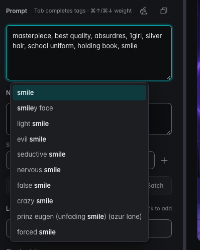

# Spellbook UI

Local image generation for people who bounced off Forge and ComfyUI.  
Beginner-friendly, private, no tokens, no subscription — your machine, your images.

**Forge is the image backend.** Spellbook drives [Stable Diffusion Forge](https://github.com/lllyasviel/stable-diffusion-webui-forge) through its API; you install Forge once, point Spellbook UI at it, and everything else (curated prompt library, pose packs, styles, batch generation, Krita handoff) lives in the Spellbook window.

[**⚡ Quick Start & Installation**](#installation) &nbsp;•&nbsp; [**🖥️ Supported Platforms**](#platforms) &nbsp;•&nbsp; [**✨ What's Inside**](#whats-inside) &nbsp;•&nbsp; [**📦 Latest Release (v1.0.0)**](https://github.com/yotycodes/Spellbook-UI/releases/latest)

---

<a id="installation"></a>
## ⚡ Installation & Quick Start

Follow these 4 simple steps to get up and running:

### Step 1: Check Prerequisites
- **[Python 3.10+](https://www.python.org/downloads/)** installed on your system.
- **[Stable Diffusion Forge](https://github.com/lllyasviel/stable-diffusion-webui-forge)** installed with at least one checkpoint/model downloaded (Illustrious, SDXL, or SD 1.5).

### Step 2: Download Spellbook UI

Choose whichever method you prefer:

#### Option A: Download Pre-packaged Release (Recommended for Beginners)
1. Go to the [**Latest Release**](https://github.com/yotycodes/Spellbook-UI/releases/latest) page.
2. Download **`Spellbook-UI-v1.0.0.zip`**.
3. Extract the ZIP file anywhere on your computer (e.g. your Desktop or Applications folder).

#### Option B: Clone via Git
```bash
git clone https://github.com/yotycodes/Spellbook-UI.git
cd Spellbook-UI
```

### Step 3: Launch Spellbook UI

Open your terminal or command prompt inside the `Spellbook-UI` folder and run the launch script for your operating system:

#### 🍎 macOS & 🐧 Linux
```bash
./standalone/launch.sh
```
*(On macOS, you can also double-click `standalone/launcher.applescript` or use the Swift native launcher).*

#### 🪟 Windows (PowerShell)
```powershell
.\standalone\launch.ps1
```

> **First Run Note:** On your first launch, Spellbook UI will automatically build its isolated Python virtual environment (`venv`) and install all required packages. This takes 2–3 minutes depending on your internet connection. Subsequent launches start in seconds.

#### 🌐 Running in Browser (Web Mode)
If you prefer running Spellbook inside your regular web browser instead of a native window:
```bash
# macOS / Linux
./standalone/launch.sh --web

# Windows (PowerShell)
.\standalone\launch.ps1 -Web
```
Then open **[http://127.0.0.1:7872/](http://127.0.0.1:7872/)** in your browser.

### Step 4: Connect to Forge

1. When the Spellbook UI window opens, navigate to **Settings** (or the first-run prompt).
2. Enter the path to your **Forge installation folder**.
3. Toggle the **Forge switch** in the left rail to start or stop Forge on demand.

---

<a id="platforms"></a>
## 🖥️ Supported Platforms

| Mode | macOS | Linux | Windows |
|---|---|---|---|
| **App mode (desktop window)** | ✅ Swift launcher or `launch.sh` window | ✅ `launch.sh` window (pywebview) | ✅ `launch.ps1` window (WebView2, built into Windows 10+) |
| **Web mode (browser)** | ✅ http://127.0.0.1:7872 | ✅ http://127.0.0.1:7872 | ✅ http://127.0.0.1:7872 |
| **Tested in CI** | ✅ | ✅ | – (best-effort) |
| **Tested on real hardware** | ✅ Apple Silicon | best-effort | best-effort |

---

<a id="whats-inside"></a>
## What's inside

- **Generate** — Forge-backed txt2img/img2img/upscale/fix, styles, pose packs,
  batch and style comparisons, wildcards.
- **Library** — import prompts from your own generations (Forge/A1111/ComfyUI
  PNGs), a sidecar file, or the 50-recipe starter shelf; the Runnable filter
  surfaces only prompts you can actually run with your models.
- **Interrogate** — image → prompt (local Ollama or Claude API).
- **Poses** — a 44-pose starter kit browsable in the rail (skeleton previews,
  SFW filter); point Spellbook at your own pose-kit folder to extend it —
  see [docs/pose-packs.md](docs/pose-packs.md).

## The prompt box

<p align="center">
  
</p>

The prompt box is the one field you live in most, so it does more than hold
text:

- **Tag autocomplete.** Type two letters and a popup suggests tags from your
  own library's vocabulary — the generations you import keep teaching it.
  `Tab` (or `Enter`, without shift) accepts, arrows navigate, `Esc` dismisses,
  and incoming `\(` / `\)` framing gets escaped correctly for Forge.
- **Weight dials on the keyboard.** `⌘↑` / `⌘↓` (Ctrl on Windows/Linux) step
  the tag under the cursor — or the current selection — through
  `(hat:1.05)`, `(hat:1.10)`, … and unwrap it cleanly when the weight returns
  to 1.0.
- **Clean tags.** The broom removes duplicates, typos and stray framing words
  from the prompt (and the negative) on demand — and quietly on blur; also
  available from the command palette as *Clean prompt in Generate*.
- **LoRA wiring.** Click an installed LoRA chip and the prompt picks up
  `<lora:name:0.8>`; click the chip again to change its weight or remove it —
  the tag in the box and the chip always stay in sync.
- **Negative lives beside it**, same autocomplete and cleaning. Autocomplete
  and the keyboard weight dials work in every prompt surface in the app
  (Generate, Krita kit, pipeline tags, inspector).

Favorite trick: send a prompt from the Library straight into the box —
history becomes a starting point, not a typing exercise.

<!-- TODO screenshots: pose rail, lightbox. -->

## Krita handoff (optional)

Krita users can push prompts, poses and images from Spellbook into a Krita
document via the bundled **AI Prompt Bridge** add-on:

1. Have Krita installed with the [Krita AI Diffusion](https://github.com/Acly/krita-ai-diffusion) plugin.
2. Copy `standalone/krita_ai_bridge/` (`__init__.py` + `krita_ai_bridge.desktop`)
   into Krita's plugin folder (`…/krita/pykrita/ai_prompt_bridge/`), enable
   **AI Prompt Bridge** in *Configure Krita → Python Plugin Manager*, and
   restart Krita.
3. Spellbook's Krita actions (Send to Krita / Pose / Reference image) light up
   when the bridge responds; without Krita everything stays disabled and
   tellingly silent — the app never requires Krita.

If you later see "Krita's AI Prompt Bridge is out of date", replace your copied
files with the current ones from this repo and restart Krita.

## Where your data lives

Nothing leaves your machine, and no personal state lives inside the repo:

- **App data** (settings, favorites, generation queue, thumbs): a platform data
  dir — `~/Library/Application Support/Spellbook` on macOS,
  `~/.local/share/Spellbook` on Linux, per-user on Windows. A checkout with a
  legacy `.beta-data/` folder keeps using it.
- **Your library** (imported prompts): `~/Documents/Spellbook UI/Library/`
  by default, chosen in first-run Settings.
- **Your styles** (generation styles): `~/Documents/Spellbook UI/Styles/`
  by default — plain JSON, editable in-app. Styles you already keep in Krita
  are still read as a fallback source.
- **Moved things**: everything is movable — `spellbook.json` next to the app
  (created with nulls on first run) and environment-variable overrides move
  app data, Forge location, pose kit and styles folders without touching source.

## Releases & Changelog

- Changes per release: [`CHANGELOG.md`](CHANGELOG.md).
- Content terms for downloadable packs: [`PACKS-LICENSE.md`](PACKS-LICENSE.md).

## License

- **App code:** AGPL-3.0 — see [`LICENSE`](LICENSE).
- **In-repo generated content** (the 44-pose starter kit, the 50-recipe starter
  shelf): AGPL-3.0, same as the engine.
- **Downloadable content packs** (paid pose kits, style presets, the free
  community kit): separate content terms — see
  [`PACKS-LICENSE.md`](PACKS-LICENSE.md). The AGPL covers the engine, not pack
  content.
- **Bundled assets:** the [Inter](https://github.com/rsms/inter) variable font
  (SIL OFL 1.1, notice in `standalone/web/vendor/inter/`) and
  [Phosphor Icons](https://phosphoricons.com) (MIT, notice in
  `standalone/web/vendor/phosphor/`).
